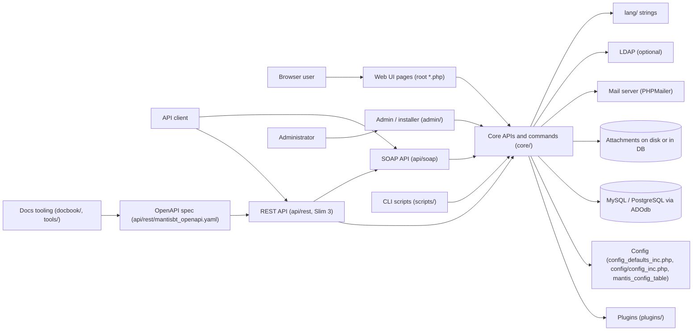

# Architecture

MantisBT is a server-rendered PHP application. Each request runs one PHP file. That file loads `core.php`, which reads the configuration, connects to the database and loads the core APIs. There is no long-running application process, no queue and no cache server.

## Web UI pages and actions

- Folder: repository root (`*.php`), plus `js/`, `css/`, `fonts/`, `images/`.
- `*_page.php` renders a page. `*_inc.php` is an include fragment. Other root files are form actions that change data and redirect, for example `bug_report.php` or `bug_update.php`.
- Every file starts with `require_once( 'core.php' )`. Layout helpers live in `core/layout_api.php` and `core/html_api.php`.
- Forms are protected by tokens from `core/form_api.php`. Request input is read through `core/gpc_api.php` (`gpc_get_int()`, `gpc_get_string()` and others).

## Core APIs and commands

- Folder: `core/`.
- `core/*_api.php`: procedural modules, one per domain (`bug_api.php`, `project_api.php`, `user_api.php`, `filter_api.php`, `workflow_api.php`, `email_api.php`, `authentication_api.php`, `access_api.php` and more). Pages load them with `require_api( 'name_api.php' )`.
- `core/classes/`: classes such as `BugFilterQuery`, `MantisEnum`, `ConfigParser`, `MantisPlugin` and the timeline events.
- `core/commands/`: one class per business action (for example `IssueAddCommand`, `IssueNoteAddCommand`, `ProjectAddCommand`). Each extends `Command` (`core/commands/Command.php`) with `validate()` and `process()`. The REST API and some web pages call them. See [decision 0002](decisions/0002-commands-shared-by-ui-and-rest.md).
- `core/exceptions/`: `ClientException`, `StateException` and other exceptions. The REST API maps them to HTTP codes.
- `core/constant_inc.php`: constants (access levels, statuses, error codes, `MANTIS_VERSION`).

## REST API

- Folder: `api/rest/`. Entry point `api/rest/index.php`, built on Slim 3.
- Middlewares in `api/rest/restcore/`: `ApiEnabledMiddleware`, `AuthMiddleware`, `CacheMiddleware`, `OfflineMiddleware`, `VersionMiddleware`.
- Routes in `api/rest/restcore/*_rest.php`: `issues`, `projects`, `users`, `filters`, `config`, `lang`, `pages`, `internal`.
- Reuses `api/soap/mc_core.php` (for example `ApiObjectFactory`) and the commands in `core/commands/`.
- The contract is `api/rest/mantisbt_openapi.yaml`. `npm run api:validate` lints it with Redocly. `npm run api:generate` builds the Postman collection, the Bruno collection and the Scalar docs into `api/rest/generated/` (gitignored).
- Clients authenticate with API tokens (`core/api_token_api.php`, table `mantis_api_token_table`).

## SOAP API (MantisConnect)

- Folder: `api/soap/`. Entry point `api/soap/mantisconnect.php`, contract `api/soap/mantisconnect.wsdl`.
- Functions are in `mc_*_api.php` files. This API is legacy; new endpoints go to the REST API.

## Admin and installer

- Folder: `admin/`.
- `admin/check/index.php` checks the PHP and server environment. `admin/install.php` creates or upgrades the schema and writes `config/config_inc.php`. `admin/schema.php` holds the list of schema upgrade steps. `admin/upgrade_unattended.php` upgrades from the command line.
- `admin/email_queue.php` shows queued emails. `admin/db_stats.php` shows table sizes.
- README.md says to remove `admin/` on live sites.

## Plugins

- Folder: `plugins/`. Base class `core/classes/MantisPlugin.class.php`, loader `core/plugin_api.php`, event list `core/events_inc.php`, events signalled with `event_signal()` from `core/event_api.php`.
- Bundled plugins tracked in git: `MantisCoreFormatting` (text and Markdown formatting, has its own PHPUnit suite), `MantisGraph`, `XmlImportExport`, `Gravatar`. Any other folder in `plugins/` is gitignored.

## CLI scripts

- Folder: `scripts/`.
- `scripts/cronjob.php` signals `EVENT_CRONJOB` for plugins. `scripts/send_emails.php` sends queued emails when `$g_email_send_using_cronjob` is ON.
- The cron schedule is set by each installation. It is not in this repository.

## Database

- Engine: MySQL/MariaDB (`mysqli`, the default `$g_db_type`) or PostgreSQL (`pgsql`). CI tests both. Access goes through ADOdb (`adodb/adodb-php`) in `core/database_api.php`.
- Schema: `admin/schema.php`. Tables use the prefix `mantis_` and the suffix `_table`.
- Main tables: `bug`, `bug_text`, `bugnote`, `bugnote_text`, `bug_history`, `bug_file`, `bug_relationship`, `bug_monitor`, `bug_tag`, `bug_revision`, `project`, `project_version`, `project_hierarchy`, `project_user_list`, `category`, `user`, `user_pref`, `user_profile`, `config`, `filters`, `tag`, `custom_field`, `custom_field_project`, `custom_field_string`, `email`, `api_token`, `tokens`, `plugin`, `news`, `sponsorship`.
- Attachments are stored in the database or on disk, depending on `$g_file_upload_method`.

## Configuration

- `config_defaults_inc.php`: defaults for every `$g_` setting, with PHPDoc.
- `config/config_inc.php`: per-installation overrides, written by the installer. The `config/` folder is gitignored. `config/config_inc.php.sample` shows the common settings.
- Some settings can be changed at runtime and are stored in `mantis_config_table` (`adm_config_report.php`, `core/config_api.php`).
- Environment variable `MANTIS_CONFIG_FOLDER` can point to another config folder.

## Localisation

- Folder: `lang/`. One `strings_<language>.txt` PHP file per language. `strings_english.txt` is the source.
- Other languages come from translatewiki.net through automated commits marked `[skip ci]`.

## External services

- Mail: `core/email_api.php` and `core/classes/EmailSenderPhpMailer.class.php` (PHPMailer: PHP mail, sendmail or SMTP). The server is set per installation.
- LDAP: `core/ldap_api.php`, optional authentication backend (`$g_login_method = LDAP`).
- Gravatar: `plugins/Gravatar`.

## Build and documentation tooling

- `build/`: release scripts (`buildrelease.py`, `buildrelease-repo.py`, see `build/README.md`), CI install scripts (`ci_install_mantis.sh`, `ci_post_install.sh`) and harness scripts (`lint_php.sh`, `local_instance.sh`).
- `docbook/`: Admin Guide and Developers Guide in DocBook, built with Publican. `docbook/Dockerfile` only builds these guides.
- `tools/openapi`, `tools/bruno`, `tools/scalar`: Node scripts behind the `api:*` npm scripts.

## Not visible in this repository

- Where and how any production instance (for example mantisbt.org/bugs) is hosted. See [deploy.md](deploy.md).
- Cron schedules, mail server, log storage and alerting for any running instance. See [observability.md](observability.md).
