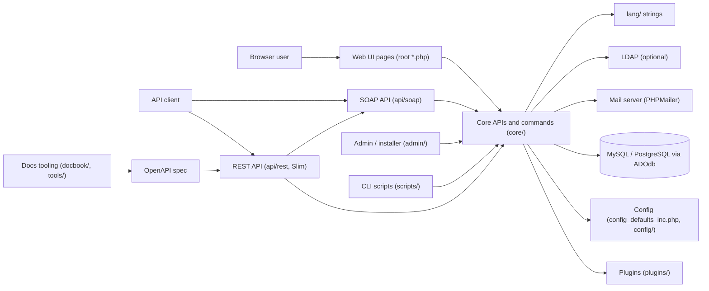

# Harness assessment: MantisBT (Mantis Bug Tracker)

Written by uw-harness 0.3.0 (spec v4) on 2026-11-01. It records what the repository showed before the harness was built. Do not edit it by hand: run `npx uw-harness analyze --force` to refresh it.

**Score before:** 27/100, level 0.

## The product

A self-hosted, open-source web bug tracker written in PHP, with a web UI, a REST API, a legacy SOAP API and a plugin system.

MantisBT lets software teams report, triage, assign and follow issues across many projects from a browser, with configurable workflows, access levels, custom fields and email notifications. Organisations install it on their own web server and database, so they keep control of their data. Integrators automate it through a REST API (OpenAPI-described) and a SOAP API, and extend it with plugins.

**Users:** Reporter (end user or customer who files issues), Developer (works on, updates and resolves issues), Manager (manages projects, versions, categories and users within a project), Administrator (installs, upgrades and configures the instance, manages users, plugins and workflow), Anonymous viewer (read-only access when anonymous login is enabled), API integrator (scripts and tools using the REST or SOAP API with API tokens), Plugin developer (extends MantisBT through events and the plugin API)

### Use cases

- **Report an issue.** A user fills the report form (project, category, severity, description, attachments, custom fields) and the issue is created, with notifications sent. Entry points: `bug_report_page.php`, `bug_report.php`, `core/commands/IssueAddCommand.php`, `api/rest/restcore/issues_rest.php`.
- **View, filter and search issues.** Users list issues with saved or ad-hoc filters, view issue details, history and relationships, and export them. Entry points: `view_all_bug_page.php`, `view_all_set.php`, `bug_view_page.php`, `core/filter_api.php`, `core/classes/BugFilterQuery.class.php`, `csv_export.php`, `excel_xml_export.php`, `api/rest/restcore/filters_rest.php`.
- **Update and resolve issues.** Developers change status, assignee, fields and versions, add notes (bugnotes), monitor, tag, relate and move issues; bulk actions are available. Entry points: `bug_update_page.php`, `bug_update.php`, `bug_change_status_page.php`, `bugnote_add.php`, `bug_actiongroup.php`, `core/commands/IssueNoteAddCommand.php`, `core/commands/IssueMoveCommand.php`, `core/workflow_api.php`.
- **Manage projects, versions, categories and custom fields.** Managers create projects and subprojects, versions, categories, custom fields and project membership. Entry points: `manage_proj_page.php`, `manage_proj_create.php`, `manage_proj_ver_add.php`, `manage_proj_cat_add.php`, `manage_custom_field_page.php`, `core/project_api.php`, `api/rest/restcore/projects_rest.php`.
- **Manage users, accounts and API tokens.** Administrators create, edit, impersonate and prune users; users manage their own account, preferences and API tokens. Entry points: `manage_user_page.php`, `manage_user_create.php`, `account_page.php`, `account_prefs_page.php`, `api_tokens_page.php`, `core/user_api.php`, `core/api_token_api.php`, `api/rest/restcore/users_rest.php`.
- **Configure workflow, thresholds and email notifications.** Administrators set status workflow, access thresholds, email notification rules and other configuration stored in the database or config files. Entry points: `manage_config_workflow_page.php`, `manage_config_work_threshold_page.php`, `manage_config_email_page.php`, `adm_config_page.php`, `config_defaults_inc.php`, `core/config_api.php`, `api/rest/restcore/config_rest.php`.
- **Install and upgrade the instance.** The web installer checks the environment, creates or upgrades the database schema and writes config_inc.php. Entry points: `admin/check/index.php`, `admin/install.php`, `admin/schema.php`, `admin/upgrade_unattended.php`.
- **Integrate through the REST and SOAP APIs.** External tools create and read issues, projects, users, filters and config through a Slim-based REST API or the SOAP MantisConnect API. Entry points: `api/rest/index.php`, `api/rest/mantisbt_openapi.yaml`, `api/soap/mantisconnect.php`, `api/soap/mantisconnect.wsdl`.
- **Roadmap, changelog, summary and news.** Users see per-version roadmap and changelog, statistics summary, timeline, news and RSS feeds. Entry points: `roadmap_page.php`, `changelog_page.php`, `summary_page.php`, `my_view_page.php`, `news_list_page.php`, `issues_rss.php`, `news_rss.php`.
- **Extend with plugins and scheduled tasks.** Plugins hook into events (formatting, graphs, avatars, XML import/export); a CLI cron script signals EVENT_CRONJOB and another sends queued emails. Entry points: `plugins/`, `core/plugin_api.php`, `core/events_inc.php`, `manage_plugin_page.php`, `scripts/cronjob.php`, `scripts/send_emails.php`.

### Glossary

| Term | Meaning |
| --- | --- |
| Bug / Issue | The tracked work item. Code and tables use 'bug' (bug_api.php, mantis_bug_table); the UI says 'issue'. |
| Bugnote | A note or comment on an issue (bugnote_api.php, mantis_bugnote_table). |
| Access level / threshold | Numeric role (VIEWER, REPORTER, UPDATER, DEVELOPER, MANAGER, ADMINISTRATOR); thresholds are config values giving the minimum level for an action. |
| Workflow | Allowed status transitions for issues, configured in manage_config_workflow_page.php and core/workflow_api.php. |
| Filter | A saved or ad-hoc query over issues (filter_api.php, BugFilterQuery, mantis_filters_table). |
| Monitor | A user who follows an issue and receives notifications (bug_monitor_add.php). |
| Sponsorship | Optional feature where users pledge money on an issue (sponsorship_api.php). |
| Command | Class in core/commands/ that implements one business action, shared by the web UI and the REST API. |
| MantisConnect (mc_) | The SOAP API; files in api/soap prefixed mc_. Its ApiObjectFactory is also reused by the REST API. |
| Event / plugin | Plugin extension points declared in core/events_inc.php and signalled with event_signal(). |
| g_ / p_ / f_ / c_ / t_ prefixes | Variable naming convention from README.md: g_ global config, p_ function parameter, f_ form input, c_ cleaned for DB, t_ temporary. |
| config_inc.php | Per-installation configuration file in config/ (gitignored) that overrides config_defaults_inc.php. |
| _page.php / _inc.php | Root file naming: *_page.php renders a page, *_inc.php is an include fragment, other root .php files are form action scripts. |
| ADOdb | Database abstraction library (adodb/adodb-php) used by core/database_api.php to support MySQL, PostgreSQL and others. |
| Publican / DocBook | Toolchain and XML format used to build the Admin Guide and Developers Guide in docbook/. |
| translatewiki.net | External site that provides localisation updates to lang/ through automated commits. |

## Stack

- Languages: PHP (>= 8.1, composer platform 8.1.34), JavaScript (front-end in js/, Node tooling in tools/), SQL (via ADOdb), Shell (CI scripts in build/), Python (release build scripts in build/), DocBook XML (docbook/)
- Frameworks: Slim 3 (REST API), ADOdb (database abstraction), PHPMailer (email), HTMLPurifier and Parsedown (formatting), Guzzle (HTTP client), PHPUnit 10.5/11.5 (tests), Redocly CLI and openapi-to-postmanv2 (OpenAPI tooling), Bruno and Scalar (API docs tooling in tools/)
- Data stores: MySQL/MariaDB (mysqli driver, default), PostgreSQL (pgsql driver, tested in CI), Other ADOdb-supported databases (README: 'or other supported database'), Local disk for attachments when file_upload_method = DISK
- External services: SMTP / sendmail mail transport (PHPMailer), LDAP directory (core/ldap_api.php, optional), Gravatar (plugins/Gravatar), translatewiki.net (localisation commits), mantisbt.org issue tracker (where issues are filed, per CONTRIBUTING.md)

## Architecture

| Component | Kind | Path | Tech | What it does |
| --- | --- | --- | --- | --- |
| Web UI pages and actions | web app | `/ (root *.php files), core.php` | PHP server-rendered pages, js/, css/ | One PHP file per page (*_page.php) or form action. Each bootstraps core.php, which loads config and connects to the database. |
| Core APIs | library | `core/` | PHP procedural *_api.php modules, core/classes, core/commands, core/exceptions | Business logic: bugs, projects, users, filters, workflow, email, auth, plugins, logging. Commands in core/commands are shared by the UI and the REST API. |
| REST API | API | `api/rest/` | Slim 3, OpenAPI spec in api/rest/mantisbt_openapi.yaml | JSON API with middlewares for auth, cache, offline and version; route files in api/rest/restcore/*_rest.php. Reuses SOAP mc_ code and core commands. |
| SOAP API (MantisConnect) | API | `api/soap/` | PHP SoapServer, WSDL | Legacy SOAP API (mantisconnect.php, mc_*_api.php). |
| Admin and installer | web app | `admin/` | PHP | Environment checks, install/upgrade (install.php, schema.php, upgrade_unattended.php), email queue and DB stats. Meant to be removed on live sites. |
| Plugins | extension | `plugins/` | PHP, MantisPlugin class, events | Bundled plugins: MantisCoreFormatting, MantisGraph, XmlImportExport, Gravatar. Other plugin folders are gitignored. |
| CLI scripts | scheduler / worker | `scripts/` | PHP CLI | cronjob.php signals EVENT_CRONJOB; send_emails.php sends queued emails when email_send_using_cronjob is on. The cron schedule itself is outside the repository. |
| Database | database | `admin/schema.php` | MySQL or PostgreSQL via ADOdb | Tables prefixed mantis_ (bug, bug_text, bugnote, bug_history, project, project_version, category, user, user_pref, config, filters, tag, plugin, email, api_token, custom_field and more). |
| Configuration | config | `config_defaults_inc.php, config/config_inc.php.sample` | PHP global $g_ variables | Defaults in config_defaults_inc.php; per-install overrides in config/config_inc.php (gitignored); some settings stored in mantis_config_table. |
| Localisation | resources | `lang/` | PHP string files | 66 language files, updated from translatewiki.net. |
| Documentation and API tooling | build tooling | `docbook/, tools/openapi, tools/bruno, tools/scalar, package.json` | DocBook/Publican (Dockerfile in docbook/), Node scripts | Builds the Admin and Developers guides and validates/generates REST API collections and docs. |
| Release build | build tooling | `build/` | Python and shell | buildrelease*.py produce release tarballs; ci_install_mantis.sh and ci_post_install.sh install and seed MantisBT in CI. |
| Mail server | external service | `core/email_api.php, core/classes/EmailSenderPhpMailer.class.php` | PHPMailer (mail, SMTP, sendmail) | Sends notifications; target server is configured per installation. |
| LDAP directory | external service | `core/ldap_api.php` | PHP ldap extension | Optional authentication backend. |

## Workflows found in the repository

- setup: `composer install`
- run local: `php -S localhost:8080`
- test: `vendor/bin/phpunit`
- lint: `npm run api:validate`
- build: `npm run api:generate`
- deploy: not found

## Requirements

### ✗ An AGENTS.md at the root

`agents-file`, level 1. Check: no AGENTS.md.

**Gap.** There is no agent entry file.

**Plan.** Create AGENTS.md (under 150 lines) with: what MantisBT is; commands (composer install, npm ci, php -S localhost:8080, vendor/bin/phpunit, npm run api:validate, plus the new check-fast/check scripts); layout (root pages, core/, api/rest, api/soap, admin/, plugins/, lang/, scripts/, tests/, docbook/, build/); conventions from README.md (g_/p_/f_/c_/t_ prefixes, tabs, *_page.php naming) and CONTRIBUTING.md (PR to master, reference a mantisbt.org issue); how tests need an installed instance; what never to do. Add CLAUDE.md containing only '@AGENTS.md'.

Reference: https://docs.unwritten.sh/harness/requirements/agents-file/

### ✗ AGENTS.md matches the repository

`agents-file-accurate`, level 1. Check: no AGENTS.md to check.

**Gap.** Nothing to verify yet.

**Plan.** Only reference npm/composer scripts that exist in package.json or composer.json (add the new ones in the same change) and only relative links to files that exist (docs/architecture.md, docs/product.md, CONTRIBUTING.md, docs/local-dev.md). Run `uw-harness check`.

Reference: https://docs.unwritten.sh/harness/requirements/agents-file-accurate/

### ✗ An architecture overview with a diagram

`architecture`, level 1. Check: no docs/architecture.md.

**Gap.** No architecture overview or diagram in the repository.

**Plan.** Create docs/architecture.md with the Mermaid diagram from this assessment, one section per component (web pages, core APIs and commands, REST, SOAP, admin/installer, plugins, scripts, config, lang, docs tooling), the main mantis_* tables from admin/schema.php, and external services (mail, LDAP, Gravatar). State that hosting and cron scheduling are not visible in the repository.

Reference: https://docs.unwritten.sh/harness/requirements/architecture/

### ◐ What the product does and for whom

`product`, level 1. Check: only README.md (104 lines), no docs/product.md.

**Gap.** No product description tied to the code entry points.

**Plan.** Create docs/product.md with the value proposition, user roles (access levels), the 10 use cases from this assessment with their entry point files, and the glossary (bug/issue, bugnote, threshold, workflow, monitor, commands, mc_ prefix, variable prefixes).

Reference: https://docs.unwritten.sh/harness/requirements/product/

### ✗ Architecture decision records

`decisions`, level 2. Check: no docs/decisions/.

**Gap.** No architecture decision records.

**Plan.** Create docs/decisions/0001-record-architecture-decisions.md (format) and 0002-commands-shared-by-ui-and-rest.md or 0002-adodb-multi-database.md, marked 'Inferred from the code, to be confirmed by the team.'

Reference: https://docs.unwritten.sh/harness/requirements/decisions/

### ✗ An implementation log

`implementation-log`, level 2. Check: no docs/harness/log.md.

**Gap.** No implementation log.

**Plan.** Create docs/harness/log.md with the first dated entry (harness added, tests need a DB-backed install), and tell agents in AGENTS.md to add one entry per significant change.

Reference: https://docs.unwritten.sh/harness/requirements/implementation-log/

### ✓ Team agreements

`agreements`, level 1. Check: CONTRIBUTING.md exists.

### ✓ One entry point for tasks

`task-runner`, level 1. Check: package.json: 5 tasks.

### ✗ A fast gate

`fast-gate`, level 2. Check: no fast gate target (for example check-fast).

**Gap.** No fast gate, and no existing PHPUnit test can run without an installed MantisBT and database; soap and rest suites also need a running web server.

**Plan.** Add composer script `check-fast`: PHP syntax lint (php -l over tracked .php files, excluding vendor/), `npm run api:validate`, and `vendor/bin/phpunit --testsuite mantis` against a local database brought up by compose (see local-env). If a DB-free gate is needed, add a small new PHPUnit suite (e.g. tests/Unit) for pure functions that do not call require_mantis_core(). Record in docs/harness/log.md which tests need DB or web server.

Reference: https://docs.unwritten.sh/harness/requirements/fast-gate/

### ✗ A full gate

`full-gate`, level 2. Check: no full gate target (for example check).

**Gap.** No single command reproduces what CI runs.

**Plan.** Add composer script `check`: check-fast plus full `vendor/bin/phpunit` (mantis, soap, rest, mantis core formatting suites) against a local install, and `npm run api:generate`. Provide a script (e.g. build/local_install.sh) that reuses build/ci_install_mantis.sh and build/ci_post_install.sh with env vars pointing at the compose database and `php -S localhost:8080`.

Reference: https://docs.unwritten.sh/harness/requirements/full-gate/

### ✓ Automated tests

`tests`, level 1. Check: 68 test files.

### ✓ CI runs the gate on every change

`ci`, level 2. Check: CI calls 2 task runner targets (api:validate, api:generate).

### ✗ Git hooks run the fast gate

`hooks`, level 3. Check: no git hooks configuration.

**Gap.** No git hooks.

**Plan.** Add .githooks/pre-push running `composer run check-fast` and set `git config core.hooksPath .githooks` from the composer `setup` script. Keep it non-blocking for contributors without a local DB (document `git push --no-verify` only as a last resort is not acceptable; instead let the hook skip DB tests when tests/bootstrap.php is absent).

Reference: https://docs.unwritten.sh/harness/requirements/hooks/

### ✗ The app runs locally with one command

`local-env`, level 1. Check: no compose file, devcontainer or dev target.

**Gap.** No one-command local environment with a database and seed data.

**Plan.** Add compose.yaml with MySQL (and optionally PostgreSQL) using the CI values (DB bugtracker, user root/root, port mapping). Add composer scripts `dev` (php -S localhost:8080) and `setup` (composer install, npm ci, install hooks, run the installer and seed via build/ci_install_mantis.sh + build/ci_post_install.sh with local env vars, which also writes tests/bootstrap.php). Write docs/local-dev.md: prerequisites (PHP 8.1+ with mysqli/pgsql, mbstring, curl, gd, soap, ldap extensions; Composer; Node; Docker), first run, reset (drop DB, delete config/config_inc.php), debugging (log_level/log_destination, MANTIS_TESTSUITE_XDEBUG_SESSION).

Reference: https://docs.unwritten.sh/harness/requirements/local-env/

### ✗ Configuration is documented, no secret in git

`env-example`, level 1. Check: no .env.example.

**Gap.** The app reads config from PHP files, not env vars; the CI/local install scripts read env vars that are not documented in an example file.

**Plan.** Add .env.example listing the variables used by build/ci_install_mantis.sh, build/ci_post_install.sh and compose.yaml (HOSTNAME, PORT, DB_TYPE, DB_HOST, DB_NAME, DB_USER, DB_PASSWORD) with safe local values and a comment pointing to config/config_inc.php.sample for application settings. Do not convert the app to env-based config.

Reference: https://docs.unwritten.sh/harness/requirements/env-example/

### ✗ Toolchain versions are pinned

`toolchain-pinned`, level 1. Check: no runtime version file.

**Gap.** Node version is not pinned and no version file exists for PHP.

**Plan.** Add .tool-versions (or mise.toml) with php 8.1 (the composer platform floor) and node 20, and add `"engines": {"node": ">=20"}` to package.json. Do not change composer platform settings.

Reference: https://docs.unwritten.sh/harness/requirements/toolchain-pinned/

### ◐ Deployment is explicit in the repository

`deploy-explicit`, level 3. Check: deployment artifacts (docbook/Dockerfile) but no docs/deploy.md.

**Gap.** MantisBT is a distributed product; how releases are published and how mantisbt.org's own instance is deployed is not written in one place.

**Plan.** Create docs/deploy.md: sections for release build (build/README.md steps, buildrelease-repo.py), installation/upgrade by users (README.md, admin/install.php), branches master and master-X.Y, rollback (restore backup per README), and uw-harness TODO blocks for who can tag and sign releases, where tarballs are published, and how the project's own tracker is upgraded.

Reference: https://docs.unwritten.sh/harness/requirements/deploy-explicit/

### ✗ Production can be observed

`observability`, level 3. Check: no docs/observability.md.

**Gap.** No document on logs, errors or health checks.

**Plan.** Create docs/observability.md describing log_level/log_destination, PHP error_log for REST errors, show_detailed_errors, admin/check as a health check, email queue monitoring, and TODO blocks for where production logs/alerts live for any instance the team runs.

Reference: https://docs.unwritten.sh/harness/requirements/observability/

### ✗ Skills for repeated tasks

`skills`, level 2. Check: no skills in .agents/skills/ or .claude/skills/.

**Gap.** No playbooks.

**Plan.** Create .agents/skills/implement-change, debug-local and rest-api-change (edit api/rest/restcore + core/commands + mantisbt_openapi.yaml, then npm run api:validate and the rest test suite), plus add-language-string (lang/strings_english.txt only; other languages come from translatewiki.net). Symlink .claude/skills to .agents/skills. Any deploy skill must link to docs/deploy.md TODOs.

Reference: https://docs.unwritten.sh/harness/requirements/skills/

## Questions for a human

- (`deploy-explicit`) Who can tag and sign a MantisBT release, and where are release tarballs published (SourceForge, GitHub releases, mantisbt.org)? build/README.md shows the tagging and build commands but not the publishing target or the people allowed to do it.
- (`deploy-explicit`) Is the project's own tracker at mantisbt.org/bugs deployed from this repository, and if so how and by whom is it upgraded? Nothing in the repository describes a running production instance of this code.
- (`observability`) For any instance the team operates (for example mantisbt.org/bugs), where are PHP error logs and MantisBT logs stored, and is there any alerting? The code only exposes log_level/log_destination and error_log; locations and alerts are not visible.
- (`fast-gate`) Is it acceptable that the fast gate needs a local database (Docker compose with MySQL), or do you want a separate DB-free unit suite added for the pre-push gate? Every existing PHPUnit test boots core.php and connects to a database.
- (`ci`) May the harness change .github/workflows/mantisbt.yml to call a composer gate script, or must CI stay as is and only a new workflow be added? The existing CI is a tuned PHP x DB matrix maintained by the core team.
- (`agreements`) What is the team's definition of done for a pull request beyond CONTRIBUTING.md (passing CI matrix, reviewer count, who merges, rebase or merge commit)? CONTRIBUTING.md states targeting and rebasing rules but not review or merge rules.
- (`local-env`) Which database should be the default for local development and the harness: MySQL/MariaDB or PostgreSQL? CI tests both; the default in config_defaults_inc.php is mysqli.

## Risks

- All PHPUnit suites are integration tests: tests/TestConfig.php require_mantis_core() loads core.php, which needs config/config_inc.php and a database; soap and rest suites also need a running web server and an API token (created by tests/ci_create_api_token.php). A naive `vendor/bin/phpunit` on a fresh clone will fail, so the gates will look broken unless setup installs MantisBT first.
- phpunit.xml uses bootstrap=tests/bootstrap.php, which is not tracked (only bootstrap.php.sample); build/ci_post_install.sh appends to it. Setup must create it.
- phpunit.xml sets failOnAllIssues=true: any PHP deprecation or warning (for example on newer PHP versions) fails the run.
- build/check_lineterm.php rewrites files when run with options; do not use it as a read-only lint.
- No PHP linter or static analyser is configured (no phpcs, phpstan, php-cs-fixer); a lint gate must be added from scratch (php -l is the safe minimum).
- Very large legacy procedural codebase (82 entries in core/, ~200 root PHP pages, global $g_ variables) with 15,000+ commits; changes can have wide side effects not covered by tests.
- dapphp/securimage is pulled from a VCS repository (github.com/mantisbt/securimage, no-api), so composer install needs network access to GitHub.
- Localisation files in lang/ (except English) are overwritten by translatewiki.net commits; agents editing them directly will have changes lost.
- admin/ is meant to be removed on live sites; harness scripts must not assume it is reachable in production.
- CI is skipped on commits containing '[skip ci]' (translatewiki commits), so those changes are never tested.
